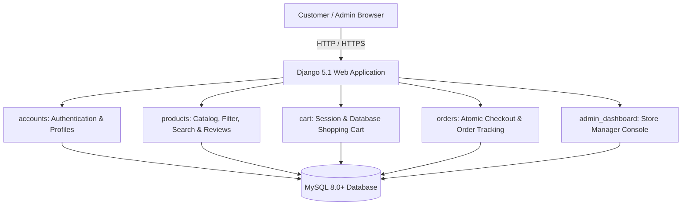

# 🛒 ShopFlow — Full Stack Python & Django E-Commerce Platform

[](https://www.python.org/)
[](https://www.djangoproject.com/)
[](https://www.mysql.com/)
[](https://getbootstrap.com/)
[](LICENSE)

**ShopFlow** is a modern, responsive, high-performance **Online Shopping Cart System & E-Commerce Web Application** built with **Python**, **Django Framework**, and **MySQL**. The user interface is crafted with **Bootstrap 5**, **JavaScript**, and custom CSS inspired by leading industry platforms such as **Amazon** and **Flipkart**.

Designed to serve as an industry-standard production template, final-year capstone project, or portfolio piece for technical interviews.

---

## 🌟 Key Highlights & Architecture

- **Full-Stack Separation of Concerns**: Modular Django architecture divided into `accounts`, `products`, `cart`, `orders`, and `admin_dashboard`.
- **Relational MySQL Database**: Comprehensive ORM models with referential integrity, indexes, and transactions.
- **Dynamic Shopping Cart**: AJAX-enabled quantity updates, stock boundary protection, and session-to-user cart merging upon login.
- **End-to-End Checkout Flow**: Multi-address management, Cash on Delivery (COD), Card/UPI payment simulation, and order status tracking.
- **Dedicated Store Manager Portal**: Front-end administrative dashboard for inventory restock, order fulfillment, and metrics reporting.
- **Customer Account Suite**: User authentication, profile editing with avatar upload, password changes, and address book.
- **Printable Tax Invoices**: Formatted invoices with print media styles for order documentation.



---

## 🗂️ Project Directory Structure

```text
onlineshoppingcart/
├── manage.py                     # Django CLI utility
├── requirements.txt              # Project dependencies
├── .env.example                  # Environment configuration template
├── .gitignore                    # Git tracking rules
├── README.md                     # Documentation & setup guide
│
├── shopflow/                     # Core Project Configuration
│   ├── __init__.py               # PyMySQL integration hooks
│   ├── settings.py               # Django configuration & DB connection
│   ├── urls.py                   # Master URL routing
│   ├── wsgi.py                   # WSGI server entry point
│   └── asgi.py                   # ASGI server entry point
│
├── accounts/                     # User Module
│   ├── models.py                 # UserProfile & Address models
│   ├── forms.py                  # Register, Login, Profile & Address forms
│   ├── views.py                  # Account views & authentication logic
│   ├── urls.py                   # Account routes
│   └── admin.py                  # Django admin registration
│
├── products/                     # Product Catalog Module
│   ├── models.py                 # Category, Product & ProductReview models
│   ├── views.py                  # Home, product list, detail & review views
│   ├── context_processors.py     # Global category navigation provider
│   ├── management/commands/
│   │   └── seed_data.py          # Database seeding command with realistic data
│   ├── urls.py                   # Product routes
│   └── tests.py                  # Catalog unit tests
│
├── cart/                         # Shopping Cart Module
│   ├── models.py                 # Cart & CartItem models
│   ├── views.py                  # Add, update, remove & AJAX handlers
│   ├── utils.py                  # Session & user cart synchronization logic
│   ├── context_processors.py     # Global navbar cart badge processor
│   ├── urls.py                   # Cart routes
│   └── tests.py                  # Cart unit tests
│
├── orders/                       # Order & Checkout Module
│   ├── models.py                 # Order & OrderItem models with status choices
│   ├── forms.py                  # Checkout & cancellation forms
│   ├── views.py                  # Checkout, place order, history & invoice views
│   ├── urls.py                   # Order routes
│   └── tests.py                  # Order transaction & stock deduction tests
│
├── admin_dashboard/              # Admin & Store Manager Module
│   ├── forms.py                  # Admin product, category & status forms
│   ├── views.py                  # KPI analytics, inventory & order views
│   └── urls.py                   # Staff portal routes
│
├── templates/                    # HTML5 Bootstrap Templates
│   ├── base.html                 # Master base template
│   ├── includes/
│   │   ├── navbar.html           # Amazon-style sticky header with search & badges
│   │   ├── footer.html           # 4-column footer with payment assurance badges
│   │   └── alerts.html           # Bootstrap alert notifications
│   ├── accounts/                 # Login, Register, Profile, Addresses, Password
│   ├── products/                 # Home page, Product List, Product Detail
│   ├── cart/                     # Interactive Shopping Cart
│   ├── orders/                   # Checkout, Confirmation, History, Detail, Invoice
│   └── admin_dashboard/          # Store Manager KPIs, Inventory, Orders
│
├── static/                       # Static Assets
│   ├── css/style.css             # Custom modern styling
│   ├── js/main.js                # UI controls & toast notifications
│   └── js/cart.js                # AJAX cart updates & reactive badges
│
└── media/                        # User Uploads
    ├── products/                 # Uploaded product imagery
    ├── categories/               # Uploaded category banners
    └── avatars/                  # Customer profile photos
```

---

## 💻 Tech Stack Details

| Layer | Technology | Details |
| :--- | :--- | :--- |
| **Backend** | Python 3.10+ & Django 5.1 | ORM, Security middleware, Form handling, Session management |
| **Database** | MySQL 8.0+ | Relational schema, foreign keys, transaction rollbacks |
| **Frontend** | HTML5, CSS3, JavaScript | Modern semantic markup, CSS variables, async fetch API |
| **UI Framework** | Bootstrap 5.3.3 & Icons 1.11 | Responsive grids, modals, alerts, cards, carousels |
| **Database Driver**| `mysqlclient` & `PyMySQL` | High-performance C and pure-Python MySQL connectivity |
| **Image Processing**| `Pillow` (PIL) | Product & profile image handling |

---

## 🚀 Step-by-Step Installation & Setup

### Prerequisites
1. **Python 3.10 or higher** installed.
2. **MySQL Server 8.0+** running locally (or via XAMPP / WampServer / Docker).
3. **Git** installed.

---

### Step 1: Clone the Repository
```bash
git clone https://github.com/your-username/onlineshoppingcart.git
cd onlineshoppingcart
```

---

### Step 2: Create and Activate Virtual Environment

**On Windows (PowerShell):**
```powershell
python -m venv venv
.\venv\Scripts\Activate.ps1
```

**On Windows (Command Prompt):**
```cmd
python -m venv venv
venv\Scripts\activate.bat
```

**On macOS / Linux:**
```bash
python3 -m venv venv
source venv/bin/activate
```

---

### Step 3: Install Required Dependencies
```bash
pip install -r requirements.txt
```

---

### Step 4: Configure MySQL Database

1. Open your MySQL client (Command Line, MySQL Workbench, or phpMyAdmin) and create the database:
   ```sql
   CREATE DATABASE online_shopping_cart CHARACTER SET utf8mb4 COLLATE utf8mb4_unicode_ci;
   ```

2. Create a `.env` file in the project root directory (or copy from `.env.example`):
   ```ini
   SECRET_KEY=django-insecure-shopflow-super-secret-key-2026-ecommerce
   DEBUG=True
   ALLOWED_HOSTS=localhost,127.0.0.1

   # MySQL Database Connection Details
   DB_NAME=online_shopping_cart
   DB_USER=root
   DB_PASSWORD=your_mysql_password
   DB_HOST=localhost
   DB_PORT=3306
   ```

---

### Step 5: Run Database Migrations
Create and execute all database tables in your MySQL instance:
```bash
python manage.py makemigrations
python manage.py migrate
```

---

### Step 6: Load Sample Product & Account Data
Populate realistic categories, products, customer records, and orders:
```bash
python manage.py seed_data
```

This automatically sets up:
- **Admin Staff Account**: `admin` / `admin123`
- **Customer Account**: `krish` / `password123`
- **6 Rich Categories**: Electronics & Gadgets, Fashion & Apparel, Home & Kitchen, Books, Beauty, Sports
- **18 Realistic Products**: With prices, discounts, stock, ratings, and image links
- **Sample Orders**: Testing for order status tracking, cancellation, and invoices

---

### Step 7: Start the Development Server
```bash
python manage.py runserver
```

Open your browser and navigate to:
```text
http://127.0.0.1:8000/
```

---

## 🔑 Demo Login Credentials

| Role | Username | Password | Access Privileges |
| :--- | :--- | :--- | :--- |
| **Customer** | `krish` | `password123` | Shopping, cart, checkout, profile, order tracking, reviews |
| **Store Admin** | `admin` | `admin123` | Full Store Manager console (`/manager/`) & Django Admin (`/admin/`) |

---

## 🧪 Running Automated Unit Tests

Execute the comprehensive test suite verifying catalog browsing, AJAX cart operations, atomic stock deductions, and order cancellations:

```bash
python manage.py test
```

Expected output:
```text
Creating test database for alias 'default'...
.........
----------------------------------------------------------------------
Ran 9 tests in 1.6s

OK
Destroying test database for alias 'default'...
```

---

## 📦 Main Application Modules Explained

### 1. User & Authentication Module (`accounts`)
- **Registration**: Custom registration form with real-time email & username uniqueness validation.
- **Login / Logout**: Session-backed authentication with automatic cart migration.
- **Profile Hub**: View order summaries, lifetime stats, and update names, email, phone, gender, and avatar.
- **Address Book**: Add multiple shipping addresses, designate default shipping addresses, edit and delete.
- **Password Security**: Dedicated password update and forgot-password recovery.

### 2. Product Catalog Module (`products`)
- **Homepage Showcase**: Hero banner carousel, features strip, department cards, deals of the day, and best sellers.
- **Search & Filters**: Multi-keyword search across product titles, descriptions, and brands.
- **Filtering & Sorting**: Filter by department, price minimum/maximum, and in-stock items; sort by newest, price asc/desc, and rating.
- **Product Details**: Image gallery, stock badge, pricing breakdown with savings calculation, and specifications.
- **Customer Reviews**: 5-star rating system with verified customer purchase reviews and average rating recalculation.

### 3. Shopping Cart Module (`cart`)
- **Hybrid Storage**: Works seamlessly for both guest visitors and authenticated users.
- **AJAX Controls**: Instant quantity increment and decrement without page reloads.
- **Stock Enforcer**: Prevents purchasing beyond available warehouse inventory.
- **Order Breakdown**: Automatic calculation of items subtotal, 5% GST tax, promotional discounts, and free shipping thresholds.

### 4. Orders & Checkout Module (`orders`)
- **3-Step Checkout**:
  1. Address selection (saved radio selector or new address form).
  2. Payment method (Cash on Delivery or Online Card/UPI simulator).
  3. Order summary review and optional delivery instructions.
- **Atomic Operations**: Database transactions guarantee that stock is decremented and cart items cleared without race conditions.
- **Live Order Tracking**: Visual 4-stage tracking bar (`Pending` &rarr; `Processing` &rarr; `Shipped` &rarr; `Delivered`).
- **Cancellation**: Customers can cancel orders in `Pending` or `Processing` status; items are atomically returned to inventory stock.
- **Printable Invoices**: Clean printable format with CSS `@media print` rules.

### 5. Store Manager Module (`admin_dashboard`)
- **Executive Metrics**: Revenue, order counts, out-of-stock items, and customer registrations.
- **Catalog Control**: Add, edit, and delete products and categories.
- **Inventory Restock**: Batch stock adjustment interface to update warehouse quantities in one step.
- **Order Fulfillment**: Change order statuses (`Shipped`, `Delivered`, `Cancelled`), enter tracking numbers, and add notes.

---

## 🔒 Security Best Practices Implemented

- **CSRF Protection**: All POST requests include `` tokens.
- **Password Hashing**: PBKDF2 with SHA-256 password hashing.
- **Access Control**: `@login_required` on checkout and profile pages; `@user_passes_test(is_staff)` on the Store Manager portal.
- **Input Sanitization**: Cleaned data methods on Django forms prevent XSS and SQL injection.
- **Zero Card Storage**: Payment simulations never store sensitive card details.

---

## 📤 GitHub Deployment Preparation

To commit and push this project to your GitHub repository:

```bash
# 1. Initialize git (if not already done)
git init

# 2. Add files to staging
git add .

# 3. Create initial commit
git commit -m "feat: complete full stack Django e-commerce platform with MySQL and Bootstrap 5"

# 4. Link to your remote GitHub repository
git remote add origin https://github.com/your-username/onlineshoppingcart.git

# 5. Push code to main branch
git branch -M main
git push -u origin main
```

---

## 📄 License
This project is open-source and available under the [MIT License](LICENSE).
